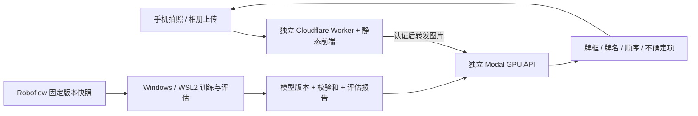

# 麻将自动识别 Web App：实施计划

日期：2026-10-25（Asia/Shanghai）

实施更新：用户已要求继续完整计划，正式域名确定为 `mahjong.avalonxty.site`，训练环境采用已授权的 Windows Conda。下文为初始方案；实际实施证据见 [PROGRESS.md](./PROGRESS.md)，其中待完成项不会因代码或预览页面存在而自动视为完成。

状态：计划完成；仅完成只读环境、账户资源和数据集元数据核验。未搭建环境、下载数据集、训练、创建云资源或部署。基础设施事实与待执行步骤见 [INFRA.md](./INFRA.md)。本文中的模型、参数、指标和预算均为待实验验证的方案，不是已取得的结果。

## 1. 建议方案与边界

复用德州扑克的 React + TypeScript + Vite、Cloudflare Worker + Static Assets 以及发布检查方式，建立独立工程。Windows 机器负责训练；Modal 按需启动 GPU 推理；Cloudflare 提供网站和同源 API。首版不引入 Neon、R2、WebSocket、消息队列或账号系统。



- 用户拍摄一组牌面可见的麻将，默认识别确认上传画面中的全部目标牌。允许先裁剪目标区域，避免把远处桌面其他牌混入手牌；结果明确基于哪张上传图。
- 支持不同牌数，不强制 13/14 张；牌背可检测为“牌背”，不能推断其正面。遮挡或不可读的牌返回不确定/建议重拍。
- 首版支持数据可证实的类别；43 个原始标签先全部保留。花牌与牌背样本较少，单独评估，不能把标准 34 类的成绩推广到全部类别。
- 默认不持久保存照片，不上传到 Roboflow，不将用户照片自动加入训练集。后续自愿提交纠错样本时，再增加独立存储与明确授权。
- 浏览器与服务端各自处理上传限制、错误和取消。取消浏览器等待并不保证云端计算停止，不据此承诺零费用。

## 2. 已确认的旧项目复用点

当前 `/Users/PROJECT_USER/Files/2_Workspace/avalon-poker` 的本地 HEAD 为 `fb40d50`，工作区干净；本地 main 与 tracking ref 对齐，本轮未 fetch。当前已迁移到 Cloudflare/Neon，以当前代码为准。

| 内容 | 当前证据 | 处理方式 |
| --- | --- | --- |
| React 19.2 / TypeScript 5.9 / Vite 7.2；CI Node 24 | `package.json`、`.github/workflows/ci.yml` | 保留栈与 Node 24，独立依赖锁文件 |
| Static Assets + `/api/*` Worker 路由 | `wrangler.jsonc`、`worker/index.ts` | 复制最小托管与路由骨架，新的 Worker/域名 |
| 手机安全区、主题、安装入口 | `src/styles.css`、`src/pwa/*` | 选择性复用；新品牌、PWA ID/scope、存储前缀 |
| 请求取消与网络状态 | `src/api/network.ts` | 提取小工具；照片切换后忽略迟到结果 |
| CI 验证与同一构建产物部署 | `.github/workflows/ci.yml`、`deploy.yml` | 独立 workflow、secrets 和 concurrency |
| Durable Objects、Neon、WebSocket、牌局规则 | `worker/room.ts`、`worker/runtime.ts` | 首版不复制 |

不能整仓复制后直接部署：旧 HTTP 层仅接收 JSON、上限 96 KiB，客户端固定 30 秒超时，均不适合照片和 GPU 冷启动；旧 App.tsx 与牌局业务耦合较重。麻将上传与结果页独立实现。不得复制旧项目 `.env*`、`.dev.vars`、数据库连接、会话密钥、DO binding、cron、生产路由。

## 3. 数据集事实与第一阶段审计

来源：[Roboflow 项目](https://app.roboflow.com/mahjong-anaun/mahjong-lfhxf/browse)；[公开来源与 CC BY 4.0 标识](https://universe.roboflow.com/mahjong-anaun/mahjong-lfhxf)。下载后保留来源、归属与修改记录，并核对每个实际使用版本的许可文件。

| 项目 | 本轮只读结果 |
| --- | --- |
| 类型与规模 | public object-detection；11,921 张；unannotated=0 |
| 类别 | 43 类：1–9m/p/s、1–7z、1–8h、back；具体中文映射待逐类图像核对 |
| 平台类别计数 | 合计 106,141；是否为标注实例数待导出核实，不能视为图片数 |
| 分布 | 常规 34 类每类 2,694–3,290；花牌每类 438–503；back=146 |
| v2 | ready；11,921 张；train 10,777 / valid 718 / test 426；无训练记录 |
| v1 | 13,678 张；train 12,384 / valid 817 / test 477；已有 yolov8n |
| v1 模型指标 | 平台 mAP50 79.11%、precision 72.72%、recall 77%；split/阈值未明确，非整手准确率 |
| 预处理、增强 | 本次接口未返回；unknown |

当前样本元数据同时包含单牌、14 张牌、cropped 截图，分辨率包括 1024×1024、3024×4032、2276×446。尚未进行图像视觉审查；不能据此宣称标注质量好或已覆盖真实棋牌室。

明确处理两个陷阱：

1. 工作区搜索 `project:mahjong-lfhxf split:test` 返回 667，而 v2 test 为 426。样本 `0Ft5Olrv4gHkC2ntZAjW` 在其他共享项目中是 test，在本项目 `projectData["mahjong-lfhxf"].split` 中是 train。后续以固定版本导出的清单为准，搜索仅用于定位样本。另一搜索接口总数 10,000 也不能替代项目规模。
2. `mahjong-yolo` 标注组被其他项目共享。先下载不可变快照，在本地修订副本与补丁清单上清洗；不直接重命名或删除原项目类别。

待执行审计：

- 获取现有 v2 的原始高分辨率和标注；核验导出权限、预处理历史及是否存在不可恢复的缩放。保留原始文件、SHA256、来源 ID、类别表、split manifest、许可与下载记录。
- 先分层查看 200–300 张：按类、牌数、分辨率、来源和场景抽样；检查漏标、错类、框不完整、重复框、非目标物、空图、坏文件、EXIF 和边缘截断。问题簇扩大检查，保存逐图处理理由。
- 统计每类实例/图片数量、框尺寸与长宽比、每图牌数、各 split 分布。中文类别映射通过图片确认，禁止凭 m/p/s/z/h 命名猜花牌序号。
- SHA256、感知哈希与近邻检索结合人工抽查去重；按同一照片衍生图、连拍、拍摄会话、牌具样式分组后划分。已有测试集若泄漏，作为历史参考重新建可信划分，并保留重划原因。
- 训练/验证/测试必须先划分再增强；原图与裁剪图、合成图源素材不能跨集合。训练集才允许重采样和增强。
- 建立独立真实手机整手测试集，目标 300–500 张，尽可能覆盖至少 5 副牌、3 个地点和3 类拍摄设备；按来源簇统计置信区间。若当前资料不足，需要后续集中补拍；合成图不能代替现场测试证据。
- 区分清楚、弱光、反光、斜拍、模糊、小目标、陌生牌具和多排；纯截图与真实照片单独报告。不可辨识图片单列拒识挑战集，不编造可见真值。

## 4. 评价标准与上线门槛

主指标 `hand_exact_match`：在有可靠真值的整手图片上，将预测牌与真值一一匹配，数量相同、每张类别正确、无漏检/多检，且定位匹配满足预先固定 IoU≥0.5，整张才记 1；否则为 0。这里 IoU 用于确定对应关系，不用 mAP 代替整手成功率。

同时报告：

- 不考虑位置的牌类多重集合完全匹配率；单排/多排顺序匹配率（如果产品承诺顺序）。
- 漏牌、重复牌、错类、误识别背景分别造成的失败比例；每类 precision/recall、混淆矩阵、mAP50/95。
- 所有可评估请求的首次自动成功率：拒识、接口失败、超时都记失败，不能从分母删除。另报模型离线准确率，以区分系统失败。
- 自动接受部分的正确率、自动接受覆盖率、重拍率；质量提示与置信度阈值在验证集校准，不把单牌概率相乘当整手真实概率。
- 场景/牌具/设备分组成绩、样本量和95%置信区间；同场景照片相关时按来源簇 bootstrap，不能把相似连拍当完全独立样本。

建议首个生产候选目标（不是当前成绩）：独立真实场景集总体整手准确率≥95%，自动接受部分整手正确率≥99%且覆盖率≥90%；分组成绩必须披露。若未达到，不以提高拒识率隐藏问题，继续分析、补数据并保留“待达到目标”状态。样本很少的花牌/牌背/陌生样式不作同等精度承诺。

性能目标：包含上传与网络的热请求 p95≤5 秒、冷请求 p95≤20 秒作为优化目标；真实网络实测后更新可达值。目标与测量均分别报告，不能用模型内核毫秒数冒充用户响应时间。

## 5. 模型实验与选择

RTX 4070 Ti 12GB 足以开展迁移学习比较，但不能预先保证大模型高分辨率的 batch。先测显存和每 epoch 时间，再确定实验总预算；每轮记录配置、随机种子、代码版本、数据 hash、权重来源/许可、GPU峰值显存和失败原因。

| 阶段 | 候选与实验 | 决策依据 |
| --- | --- | --- |
| E0 可复现基线 | 用统一新划分训练轻量基线；既有 v1 yolov8n若可下载，仅在证明其训练清单与评估图无原图/近重复交集时纳入比较 | 无法证明旧模型未见评估图片时，只作流程验证和历史参考，不参与公平排名；不调用付费托管推理 |
| E1 架构筛选 | RF-DETR S/M、RT-DETRv2 R18/R50；允许许可路径时加入 YOLO26 s/m，YOLO11为成熟备选；每个家族先一组 | 同一训练/验证清单；先短程20–30 epochs看学习曲线，避免一次跑全网格 |
| E2 准确率优化 | 最有希望的两组完成80–150 epochs上限/早停；比较640附近与960/1024附近合法输入尺寸，显存允许再试更大档 | 验证集整手指标优先；RF-DETR按所选checkpoint合法尺寸，不能任意填尺寸 |
| E3 结构改进 | 若错类多而定位可靠：检测后原分辨率裁牌 + 分类；若小牌漏检：ROI/高分辨率/局部重检；确需透视校正再补四角或分割标注 | 只有错误分析支持时增加第二阶段，端到端评估检测框裁剪误差 |
| E4 稳健性 | 前两名至少2个种子；差异不稳定再加第3个；消融增强、阈值、有限重检/集成 | 在验证集选方案；模型、导出产物和部署配置全部冻结后才解封独立测试集，不循环用测试集调参 |

短程表现差但尚未收敛的架构，先看曲线再淘汰。统一数据和评价，但允许合理的架构专用优化器/训练配置；记录算力开销，不宣称简单相同 epoch 就绝对公平。

训练策略：迁移学习、混合精度、自动探测可用 batch；初始 physical batch 1–4，仅作探测起点；必要时梯度累积到有效 batch 16左右。先跑小样本过拟合与单 epoch 流程验证，再长训。保留 last/best、optimizer/scheduler、随机状态与数据版本以支持断点恢复。

预处理和增强：保持纵横比、统一 EXIF 方向、使用可恢复到原图坐标的缩放/letterbox。先禁用水平/垂直镜像和强裁剪；麻将字形镜像不符合目标场景。采用与拍摄分布匹配的轻旋转、透视、亮度/色温、局部眩光、运动/失焦模糊、JPEG压缩，强度经可读性抽查确定。花牌补充与困难样本挖掘优先于盲目增加增强数量。

RF-DETR 官方默认包含50%水平翻转及 resize/crop jitter，须显式覆盖并锁定实际增强配置；详情见[官方增强说明](https://rfdetr.roboflow.com/latest/learn/train/augmentations/)。更大模型不自动获胜，COCO榜单只用于形成候选。

后处理：原图坐标还原、按牌排列方向分组排序、按具体模型选择去重/NMS策略；密集相邻牌不能被过度抑制。同类最多四张、总数十四张仅能提示异常，不能强行改预测或补牌。低置信目标可做一次受限局部重检；重复框与类别冲突要保留诊断记录。

许可安排：RF-DETR core S/M/L 与官方 RT-DETR 路线优先；RF-DETR XL/2XL 并非相同许可，暂不作为默认。Ultralytics 代码/权重的 AGPL或商业许可路径在选用前核对，不自动购买许可证。没有许可可用性确认的候选不进入正式部署。

官方参考：[RF-DETR 模型与许可](https://rfdetr.roboflow.com/latest/learn/run/detection/)、[训练参数](https://rfdetr.roboflow.com/latest/learn/train/training-parameters/)、[RT-DETR 官方实现](https://github.com/lyuwenyu/RT-DETR)、[YOLO26 官方文档](https://docs.ultralytics.com/models/yolo26/)。

## 6. 导出、Modal 与成本验证

先用 PyTorch FP16作为功能参考，保留可直接回退的权重。对最终候选比较 ONNX Runtime CUDA 与 TensorRT FP16；TensorRT engine 在目标 GPU/运行时构建并按GPU型号、CUDA、TensorRT和模型 hash缓存，不把4070 Ti生成的engine直接当作L4/T4可移植产物。INT8仅在需要且校准数据充分时考虑。

每次导出在验证集与固定导出回归集上重新跑整手指标、困难样本及坐标一致性，比较预测差异；不使用封存测试集选择运行时、精度或预处理。建议精度回退上限0.2个百分点，且新出现的关键错牌全部检查；不达标则保留PyTorch路径。模型、导出产物、预处理/阈值和部署配置全部冻结后，才运行独立测试并生成最终报告。选型以用户总延迟和整手指标为准，复杂优化没有收益就不保留。

Modal：独立 App与版本化模型路径；模型容器初始化时加载一次。首测L4与T4，`min_containers=0`、`max_containers=1`、无常驻预热；比较15/30/60秒空闲回收配置，按实测冷启动、到达间隔和成本选择。对外端点使用 proxy auth，凭据仅在Worker secrets中；普通站点健康检查不唤醒GPU。

2026-10-25公开价：[Modal Starter每月$30额度](https://modal.com/pricing)，L4 $0.000222/秒、T4 $0.000164/秒；账户是否适用、当前剩余额度及付款设置尚未验证。CPU、内存、启动加载和空闲等待等均需计入，免费额度不能等同永久零账单。

以下只是敏感性估算：L4 + 1物理CPU核 + 4GiB内存，按每月1000次、每次独立计费存活时间估计；费率合计约$0.00024398/秒。存储、构建、实验、其他应用开销另计，实际CPU/内存使用更高也会增加费用。

| 每次平均计费存活时间（加载+推理+空闲） | 月计算费用估计，抵扣前 |
| --- | --- |
| 10秒 | $2.44 |
| 30秒 | $7.32 |
| 60秒 | $14.64 |
| 120秒 | $29.28 |

上线前至少测热请求、连续批次与真实scale-to-zero后的冷请求；记录有效推理时间、容器存活时间和估计费用。预算按账户所有工作负载合并核算。`max_containers`只限制并发，不是月费用上限。默认目标为新增现金支出$0；需要超过免费额度、购买许可或套餐升级时再给出具体金额并请求批准。

Modal官方区分抵扣前usage budget和抵扣后的spend limit；后续以实际账户设置验证并配置可用的费用上限。Starter不假定拥有独立environment budget，也不擅自更改影响其他项目的workspace总预算。[预算说明](https://modal.com/docs/guide/budgets)、[缩容说明](https://modal.com/docs/guide/scale)。

## 7. 前后端行为与接口

单页主流程：拍照/上传 → 原图预览与可选裁剪/旋转 → 识别 → 框选照片 + 紧凑牌列表。点击牌查看不确定原因或修正；人工修改单独标识，不计入模型自动准确率。新照片自动替换旧预览，及时释放图片资源。

- 手机宽度320–430px不横向溢出；触摸区≥44px，安全区适配；加载反馈不挤压结果区域。慢请求展示进度状态与取消入口，不能伪造百分比。
- 优先浏览器原生相机/相册入口。支持JPEG/PNG/WebP；iPhone HEIC/HEIF需验证浏览器转换或Modal CPU侧解码，无法解码给清晰提示。验证EXIF旋转、超大像素、暗光、相册权限和重新拍摄。
- 先在不损伤牌面细节的前提下评估长边1600–2560压缩上传；不能先把所有照片压到640。上传图与最终模型输入分开管理，UI框坐标对应最终上传图。
- 拟定上传上限12MiB、解码上限40MP，经过真实手机样本校准。Worker流式限制字节并转发，不解码图片、不做base64 JSON、不缓存POST/照片；Modal在解码前后做内容与像素检查。
- API：`POST /api/recognize`接收一张图片；返回 `requestId`、`modelVersion`、图像尺寸、`tiles[{classId,label,bbox,score,uncertain}]`、排序、质量提示与耗时。API结果不包含秘密或原图永久URL。
- 状态区分`ok`、`needs_retake`、`busy`及明确错误；400/413/415输入问题，429限流，503/504服务/超时。低置信不能假装“全部识别正确”。
- Worker校验限流/必要的Turnstile，使用平台级proxy auth保护Modal源站；CORS/Origin只作补充，不能代替认证和防滥用。
- 初版同步请求；请求编号贯穿全链路。冷启动等待预算初设60秒并实测。前端不自动重发识别POST；超时说明原任务可能仍在完成，防止静默重复计费。若实测大量请求超出合理等待再引入任务轮询和持久化去重，不预建复杂队列。
- `GET /api/health`只检查版本与配置存在性，不声称GPU可用；发布验收另执行一张真实图片推理并校验结果。
- 日志仅保留请求ID、模型版本、大小、耗时、错误码，不记录图像正文、凭据或EXIF位置。离线PWA不重放识别请求。

Cloudflare首版使用Static Assets加极薄的代理Worker。静态资源请求免费，动态请求受账户计划限制；免费计划10ms CPU意味着图片处理放Modal，实际代理CPU需测量。[Static Assets计费](https://developers.cloudflare.com/workers/static-assets/billing-and-limitations/)、[Workers限制](https://developers.cloudflare.com/workers/platform/limits/)。

## 8. 工程组织与可复现交付

以下为未来创建的结构，本轮只创建计划文档：

```text
mahjong/
  apps/web/                  # React拍摄、预览、结果页
  apps/worker/               # 上传代理、限制与错误处理
  ml/data/                   # 快照、审计、划分、类别映射工具
  ml/train/                  # 各架构训练适配器
  ml/eval/                   # 整手指标、分组评估、导出一致性
  ml/inference/              # 训练外可复用的预处理/后处理
  infra/modal/               # GPU API与模型加载
  configs/                   # 模型、数据、训练、阈值的版本配置
  scripts/                   # SSH同步、断点恢复、导出、发布验证
  tests/                     # 指标/接口/前端与真实模型回归
  docs/                      # 数据说明、模型卡、部署/更新手册
  artifacts/manifests/       # 权重hash和报告索引；不提交大权重/原图
```

采用简单npm和Python项目，避免为首版引入复杂monorepo工具。版本标识包含代码commit、数据manifest hash、class map版本、训练配置hash、权重SHA256、推理配置和导出环境。原图/权重存训练机与备份/Modal模型存储，不进入Git；清洗补丁与划分清单可追溯。

训练任务经已有SSH入口触发WSL中的持久进程，SSH断开不终止训练。先验证短任务断线恢复，再跑长任务；日志与checkpoint可拉取，训练进程有PID/任务ID且禁止重复启动同一run。不会依赖Mac持续在线。

模型更新流程：新数据隔离审计 → 更新版本化清单 → Windows重新训练 → 验证集选方案 → 导出回归与Modal staging性能验证 → 冻结模型/导出/部署配置 → 独立测试报告与手机端验收 → 切换production模型版本。失败时回到上一份已验证的代码+模型+配置组合；不能只回退网页。旧测试集一旦被反复用于调参需标记失去独立性并补充新测试集。

## 9. 执行顺序、交付与验收

| 阶段 | 具体产物 | 完成判定 |
| --- | --- | --- |
| P0 本轮计划 | PLAN.md、INFRA.md | 事实与待执行项分开；无训练/部署/付费资源变更 |
| P1 基础设施 | 独立仓库、WSL环境、锁文件、Modal认证与预算核验、Cloudflare部署身份 | GPU张量/小模型前后向通过；SSH中断恢复通过；账户只读查询通过 |
| P2 数据审计 | dataset card、class map、清洗补丁、固定split、现场测试集清单 | 无已知跨集合近重复；关键标注缺陷已修；真实场景证据足够，否则明确缺口 |
| P3 基线与筛选 | E0–E2实验表、失败图库、最有希望两组 | 同一整手评估可复现；精度/显存/耗时实际记录 |
| P4 前后端（可与P3并行） | 拍照上传、预览、真实结构的接口、结果和错误状态 | 手机基础流程通过；模拟接口测试只算工程验证，不算模型验收 |
| P5 最终模型与优化 | 最终权重、模型卡、测试报告、导出比对 | 达到目标或明确记录未达项；不能以Demo完成代替性能达标 |
| P6 云端与端到端 | 独立Modal/Worker staging→production、HTTPS访问地址 | 真实上传→真实GPU→结果通过；冷/热/限流/异常场景和大陆网络验证 |
| P7 运维交接 | 重训/发布/回退手册、成本实测、已知限制 | 另一环境按锁文件与脚本复现；版本可追溯与回退；现有Poker无变更 |

关键路径是P1→P2→P3→P5→P6；P4并行。P1/P2各预留约0.5–2个工作日，模型实验约2–5个训练日，前端约1–2日并行，部署验收约1–2日；初步工程窗口约5–10个工作日，不含必要的现场补拍/权限等待。准确训练时长以首个epoch实测校正，不承诺在缺数据情况下按时达到精度。

端到端验收清单：iOS Safari、Android Chrome及可取得的真实设备；320/390/430px；JPEG/HEIC、EXIF、横竖拍；缺牌/重复/空背景/眩光/模糊；多次选择图片；慢网/断网/取消/迟到结果；冷启动、并发排队、超时、限流、超限文件；模型版本回退；从实际使用地的家庭网络与移动网络直连访问。Cloudflare/Modal在大陆的可达性和延迟必须实测，不能由本机控制台能访问推断。浏览器仿真与真实手机测试分别记录。

仅以下事项届时需要集中用户参与：Modal首次登录或付款资料/必要账户权限；Windows需要重启而可能打断正在使用的任务；确实缺少的现场照片；任何新增付费套餐、许可或超过已确认免费额度的方案。其余已授权范围内的工程选择由实施方处理。
